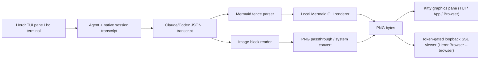

# Herdr Preview

[](https://github.com/Volpestyle/herdr-plugin-mermaid-preview/actions/workflows/ci.yml)
[](LICENSE)

Herdr Preview watches the native Claude Code or Codex transcript behind a Herdr
pane or `herdr-core` (`hc`) terminal and displays what it finds live. It works
across all three Herdr environments:

- **Herdr TUI** (`herdr` 0.7.1 – 0.9.5+) — managed plugin tab over Kitty graphics
- **Herdr App** (`herdr-app` + `hc`) — native Kitty graphics terminal tab/split
  plus a native GPUI launcher mod (`mods/herdr-preview`)
- **Herdr Browser** (`herdr-app-browser` fork) — both native Kitty terminal mode
  and a live-reloading native Chromium preview mode (`--browser`)

It ships with two sources:

- **Mermaid** — every complete `mermaid`-fenced block in an assistant message,
  rendered locally and offline.
- **Images** — every image in the session: what you paste in, and what the agent
  looked at with its read tool. Screenshots it takes show up here without any
  filesystem watching, because the bytes are already in the transcript.

The preview follows session changes such as resume and clear, keeps every
distinct item from the current session, and selects the newest one. Use `+`/`-`
to zoom, the arrow keys or `h`/`j`/`k`/`l` to pan, and `0` to reset the
viewport. Use `n`/`p` or `]`/`[` to browse, `r` to rerender, and `q` to close.

## Requirements

- Node.js 22.12 or newer
- One of:
  - **Herdr TUI** 0.7.1 or newer with `[experimental] kitty_graphics = true` in
    a Kitty-graphics-compatible outer terminal (such as Ghostty)
  - **Herdr App** (`herdr-app`) with `herdr-core` (`hc`) — Kitty graphics work
    natively out of the box
  - **Herdr Browser** (`herdr-browser`) with `herdr-core` (`hc`) — supports both
    native Kitty graphics terminals and native Chromium browser panes

## Install

### Herdr TUI (`herdr`)

Install the plugin directly from GitHub (or update an existing install on Herdr
0.9.5+ with `herdr plugin update`):

```bash
herdr plugin install Volpestyle/herdr-plugin-mermaid-preview
```

Install Herdr's session-identity integration for each agent you use:

```bash
herdr integration install claude
herdr integration install codex
```

Enable Kitty graphics in `~/.config/herdr/config.toml`:

```toml
[experimental]
kitty_graphics = true
```

After enabling Kitty graphics for the first time, detach and reattach the Herdr
client once so it renegotiates graphics frame support. The Herdr server, panes,
and agents remain running.

Open a preview for the focused Claude Code or Codex pane:

```bash
herdr plugin action invoke dev.volpestyle.mermaid-preview.open         # diagrams
herdr plugin action invoke dev.volpestyle.mermaid-preview.open-images  # images
```

Optional Herdr TUI keybindings make the previews prefix commands:

```toml
[[keys.command]]
key = "prefix+m"
type = "plugin_action"
command = "dev.volpestyle.mermaid-preview.open"
description = "open Mermaid preview"

[[keys.command]]
key = "prefix+i"
type = "plugin_action"
command = "dev.volpestyle.mermaid-preview.open-images"
description = "open image preview"
```

### Herdr App (`herdr-app`) and Herdr Browser (`herdr-browser`)

Clone the repo and install dependencies:

```bash
git clone https://github.com/Volpestyle/herdr-plugin-mermaid-preview.git
cd herdr-plugin-mermaid-preview
npm ci
```

Install the native GPUI launcher mod into your app home:

```bash
npm run install:app      # installs into ~/.config/herdr-app/mods/herdr-preview
npm run install:browser  # installs into ~/.config/herdr-app-browser/mods/herdr-preview
npm run install:all      # installs into both
```

Verify the mod with the app's checker:

```bash
herdr-app check ~/.config/herdr-app/mods/herdr-preview
# or, for Herdr Browser:
herdr-browser check ~/.config/herdr-app-browser/mods/herdr-preview
```

Bind a shortcut in `~/.config/herdr-app/keys.json` (or
`~/.config/herdr-app-browser/keys.json`) to open the Herdr Preview dialog from
anywhere:

```json
{
  "global": {
    "cmd-shift-m": "mod.open:herdr-preview"
  }
}
```

Or run the CLI directly from any terminal inside Herdr App or Herdr Browser
(optionally run `npm link` to put `herdr-preview` on `PATH`):

```bash
node bin/herdr-preview.mjs mermaid --place right
node bin/herdr-preview.mjs images --place tab
node bin/herdr-preview.mjs mermaid --target t7 --place right

# Herdr Browser native Chromium preview (smooth wheel zoom, drag pan, live SSE):
node bin/herdr-preview.mjs mermaid --browser --place right
```

The launcher auto-detects Herdr TUI, Herdr App, and Herdr Browser (or pass
`--runtime tui|app|browser`). Re-invoking it for the same target and source
reuses and focuses the existing preview tab or split.

## Develop locally

```bash
npm ci
herdr plugin link "$PWD"   # for Herdr TUI
npm run install:app        # for Herdr App
npm run install:browser    # for Herdr Browser
npm run check
```

## How it works



A source is an extractor plus a renderer, registered in `src/sources/index.mjs`.
The viewer knows only about items that have a hash and produce PNG bytes, so the
viewport, encoder, browser server, and transcript follower are shared by both.

- **Herdr TUI** reads the native session ID and transcript path reported by
  `herdr pane get`.
- **Herdr App and Herdr Browser** read terminal metadata from `hc get --json`
  and resolve the transcript from explicit session labels/flags (`--session-id`,
  `--resume`), Claude Code PID session files (`~/.claude/sessions/<pid>.json`),
  or the active transcript matching the terminal's working directory under
  `~/.claude/projects/` or `~/.codex/sessions/`.

Diagram and image data stay in memory, bounded to the most recent 100 items and
8 decoded frames (16 in browser mode); anything written while converting a
non-PNG image lives in a private temporary directory and is removed when the
preview exits.

Kitty takes PNG directly, so PNG images are passed through unmodified and the
zoom/pan crop is applied as a source rectangle against the original. Other
formats are converted by whatever the machine already provides — `sips` on
macOS, ImageMagick or ffmpeg elsewhere — which keeps image handling out of both
the dependency tree and the browser. Rendering uses Mermaid's strict security
mode, denies every browser request except Mermaid CLI's allowlisted local
package assets, and enforces a 100,000-byte source limit. Diagrams containing
image nodes, URLs, CSS imports, or other external resource syntax fail closed
with a visible preview error.

See [docs/architecture.md](docs/architecture.md) for the screen-scraping
decision, runtime adapters, and security boundaries.

## Troubleshooting

- **Herdr TUI tab opens but stays empty:** after first enabling Kitty graphics,
  detach and reattach the Herdr client so it renegotiates graphics frame
  support.
- **Herdr App / Herdr Browser says no agent detected:** make sure the target
  terminal is a local Claude Code or Codex session (remote `machine/tN`
  terminals keep their transcripts on the remote machine).
- **An image says it cannot be displayed:** its format is not PNG and the
  machine has no converter. Install ImageMagick or ffmpeg.
- **A pasted image never appears:** transcripts elide image payloads when a
  session is compacted, leaving a block with an empty source. Those images are
  no longer recoverable from the transcript.
- **Herdr TUI tab waits for session identity:** install the matching Herdr
  integration with `herdr integration install claude` or
  `herdr integration install codex`, then start a new agent session.
