# Herdr Mermaid Preview

[](https://github.com/Volpestyle/herdr-plugin-mermaid-preview/actions/workflows/ci.yml)
[](LICENSE)

Herdr Mermaid Preview watches the native Claude Code or Codex session behind a
selected Herdr pane. When an assistant message contains a complete
`mermaid`-fenced block, the plugin renders it locally and displays it in a live
Herdr tab through the Kitty graphics protocol.

The preview follows session changes such as resume and clear, keeps every
distinct diagram from the current session, and selects the newest diagram.
Use `+`/`-` to zoom, the arrow keys or `h`/`j`/`k`/`l` to pan, and `0` to
reset the viewport. Use `n`/`p` or `]`/`[` to browse diagrams, `r` to rerender,
and `q` to close the preview.

## Requirements

- Herdr 0.7.1 or newer with agent session identity exposed by `pane get`
- `[experimental] kitty_graphics = true` in the Herdr configuration
- Ghostty or another Kitty-graphics-compatible outer terminal
- Node.js 22.12 or newer

## Install

Install the plugin directly from GitHub:

```bash
herdr plugin install Volpestyle/herdr-plugin-mermaid-preview
```

Install Herdr's session-identity integration for each agent you use:

```bash
herdr integration install claude
herdr integration install codex
```

Enable Kitty graphics in `~/.config/herdr/config.toml`:

```toml
[experimental]
kitty_graphics = true
```

After enabling Kitty graphics for the first time, detach and reattach the Herdr
client once so it renegotiates graphics frame support. The Herdr server, panes,
and agents remain running.

Open a preview for the focused Claude Code or Codex pane:

```bash
herdr plugin action invoke dev.volpestyle.mermaid-preview.open
```

The action uses Herdr's pane context when invoked from a keybinding or menu and
falls back to the currently focused pane when invoked from the CLI. It opens and
focuses a dedicated preview tab in the source pane's workspace. Invoking the
action again reuses and focuses the existing preview.

An optional Herdr keybinding makes the preview a prefix command:

```toml
[[keys.command]]
key = "prefix+m"
type = "plugin_action"
command = "dev.volpestyle.mermaid-preview.open"
description = "open Mermaid preview"
```

## Develop locally

```bash
npm ci
herdr plugin link "$PWD"
npm run check
```

## How it works

```mermaid
flowchart LR
  Herdr["Selected Herdr pane"] --> Identity["Agent + native session ID"]
  Identity --> Transcript["Claude/Codex JSONL transcript"]
  Transcript --> Fence["Complete Mermaid fence parser"]
  Fence --> Renderer["Local Mermaid CLI renderer"]
  Renderer --> PNG["Ephemeral PNG"]
  PNG --> Viewport["Zoom + pan source viewport"]
  Viewport --> Kitty["Kitty graphics encoder"]
  Kitty --> Preview["Managed Herdr preview pane"]
```



The plugin reads only the transcript for the selected pane's reported native
session. Diagram source stays in memory; rendered PNGs live in a private
temporary directory and are removed when the preview exits. Rendering uses
Mermaid's strict security mode, denies every browser request except Mermaid
CLI's allowlisted local package assets, and enforces a 100,000-byte source
limit. Diagrams containing image nodes, URLs, CSS imports, or other external
resource syntax fail closed with a visible preview error.

See [docs/architecture.md](docs/architecture.md) for the screen-scraping decision
and runtime boundaries.

## Troubleshooting

- **The tab opens but stays empty:** after first enabling Kitty graphics, detach
  and reattach the Herdr client so it renegotiates graphics frame support.
- **The tab waits for session identity:** install the matching Herdr integration
  with `herdr integration install claude` or `herdr integration install codex`,
  then start a new agent session.
