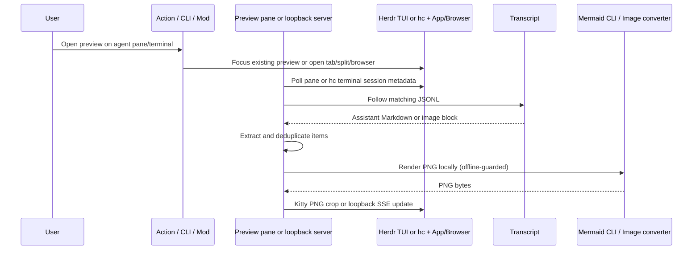

# Architecture

## Decision: use native transcripts as the source

Claude Code and Codex render Markdown before writing their terminal screens.
The rendered pane contains the Mermaid source but not the opening language
fence, so terminal snapshots cannot reliably distinguish Mermaid from an
ordinary code block.

- In **Herdr TUI**, the plugin uses the agent type, native session ID, and
  authoritative transcript path reported by `herdr pane get` to locate the
  append-only JSONL transcript, with directory discovery as a fallback.
- In **Herdr App** and **Herdr Browser** (`herdr-core` / `hc`), `hc get --json`
  does not store agent session IDs. The `hc` adapter (`src/hc.mjs`) resolves
  the agent from OSC 7501 `status.app`, labels, or process `argv`, then locates
  the transcript in priority order:
  1. Explicit session labels (`herdr.session_path`, `herdr.session_id`,
     `clankie.session`) or CLI flags (`--session-id`, `--resume`, `-r`,
     `codex resume`).
  2. Claude Code PID session records (`~/.claude/sessions/<pid>.json`).
  3. The newest transcript matching the terminal's live working directory under
     `~/.claude/projects/<encoded-cwd>/*.jsonl` (Claude) or
     `~/.codex/sessions/**/rollout-*.jsonl` whose `session_meta.payload.cwd`
     matches (Codex).

Alternatives considered:

- **Screen scraping:** requires diagram-type heuristics because the TUI removes
  the fence. It also breaks when either agent changes its Markdown styling.
- **Raw PTY attachment:** observes redraw instructions after Markdown rendering,
  so it has the same lost-language problem plus ANSI parsing complexity.
- **Harness-specific output hooks:** preserve structure but require separate
  lifecycle integrations in every agent and make installation harder.

## Decision: images come from the transcript, not the filesystem

Both harnesses store image content blocks as base64 inside the session JSONL,
so the transcript the Mermaid source already follows is also a complete record
of every image in the conversation. Watching a directory or scraping paths out
of prose would add a second discovery mechanism and still miss pasted images,
which never touch disk.

Three shapes matter and none is obvious from the schema:

- Images the agent looked at arrive **nested inside a `tool_result` block**
  (`message.content[].content[]` in Claude; `function_call_output` /
  `custom_tool_call_output` arrays in Codex), not only at the top level.
- `media_type` is frequently absent, so format is decided by magic bytes.
  Trusting a missing or wrong media type sends a JPEG down the PNG passthrough
  and fills the terminal with garbage.
- Compaction elides payloads in place, leaving `"source": {}`. Those blocks are
  placeholders for an image that is gone, and are skipped rather than rendered
  as an error.

## Decision: one backend across TUI, App, and Herdr Browser

- **Kitty terminal viewer (`src/preview.mjs`)** works identically in Herdr TUI
  (through its Kitty graphics pass-through) and in Herdr App / Herdr Browser
  (whose `libghostty-vt` terminal decodes PNGs and crops Kitty source rectangles
  natively with no experimental flags).
- **Native GPUI mod (`mods/herdr-preview/`)** integrates directly into Herdr App
  and Herdr Browser (`mod.open:herdr-preview`), discovering live local Claude
  Code and Codex terminals via `terminals()` / `agents()`, focusing existing
  previews, or spawning a tab/split directly via `run("tab.new" | "pane.split")`.
- **Optional Herdr Browser native web viewer (`src/browser-preview.mjs`)**
  serves the already-rendered offline PNGs over a token-gated `127.0.0.1`
  HTTP+SSE server with a strict offline CSP (`default-src 'none'; img-src
  'self'; ...`) and opens it via `herdr-browser do browser.open`. It exits
  automatically after its SSE clients disconnect so closing the browser pane
  leaves no background server behind.

## Runtime flow

## Boundaries

- The plugin supports local `claude` and `codex` transcripts explicitly.
  Remote `machine/tN` terminals fail visibly because their transcripts live on
  the remote host.
- A session identity change resets the item list to the new session.
- Transcript and Mermaid errors fail visibly in the preview instead of falling
  back to ambiguous screen heuristics.
- Diagram source stays in memory. Temporary PNG files live in a mode-restricted
  directory (`0700`) and are removed when the preview exits.
- Zoom and pan reuse cached PNGs without rerunning Mermaid or writing derivative
  files.
- Chromium denies all browser requests except Mermaid CLI's reserved,
  allowlisted package-asset origin. Assistant-authored HTTP, private-network,
  localhost, and file requests are aborted before I/O.
- The Herdr Browser loopback server binds only `127.0.0.1`, verifies `Host` and
  `Origin`, checks the per-run random token in constant time, and serves with a
  no-external-network Content Security Policy.
