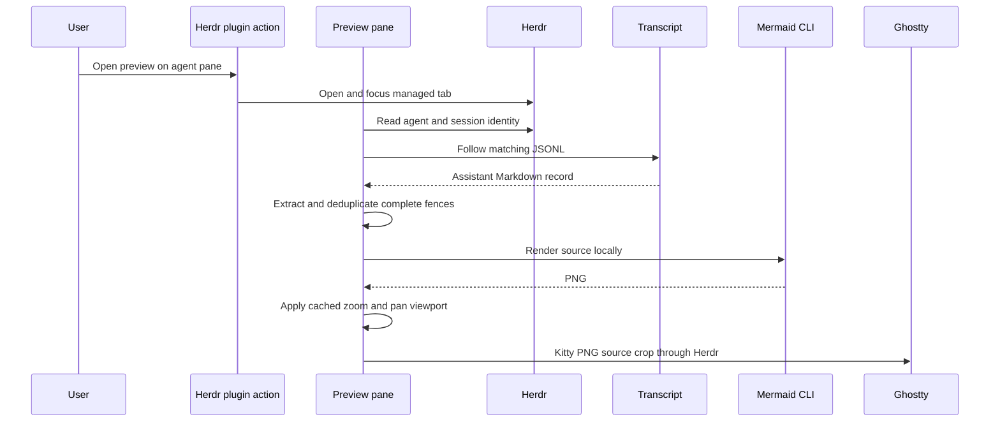

# Architecture

## Decision: use native transcripts as the source

Claude Code and Codex render Markdown before writing their terminal screens.
The rendered pane contains the Mermaid source but not the opening language
fence, so Herdr's terminal snapshot cannot reliably distinguish Mermaid from an
ordinary code block.

The plugin uses the agent type, native session ID, and authoritative transcript
path reported by Herdr to locate that session's append-only JSONL transcript.
Directory discovery is a fallback for harnesses that report an ID without a
path. The adapter accepts only assistant text records and extracts complete
Mermaid fences from the original Markdown.

Alternatives considered:

- **Screen scraping:** requires diagram-type heuristics because the TUI removes
  the fence. It also breaks when either agent changes its Markdown styling.
- **Raw PTY attachment:** observes redraw instructions after Markdown rendering,
  so it has the same lost-language problem plus ANSI parsing complexity.
- **Harness-specific output hooks:** preserve structure but require separate
  lifecycle integrations in every agent and make the plugin harder to install.

Native transcript adapters preserve the source structure while keeping Herdr
responsible only for pane/session identity and presentation.

## Runtime flow

## Boundaries

- The plugin supports `claude` and `codex` transcript schemas explicitly.
- A session identity change resets the diagram list to the new session.
- Transcript and Mermaid schema changes fail visibly in the preview instead of
  falling back to ambiguous screen heuristics.
- Diagram source stays in memory. PNGs are mode-restricted temporary files and
  are deleted when the preview process exits.
- Zoom and pan reuse the cached PNG. The Kitty placement source rectangle crops
  the visible region without rerunning Mermaid or creating derivative files.
- Chromium denies all browser requests except Mermaid CLI's reserved,
  allowlisted package-asset origin. Assistant-authored HTTP, private-network,
  localhost, and file requests are aborted before I/O.
